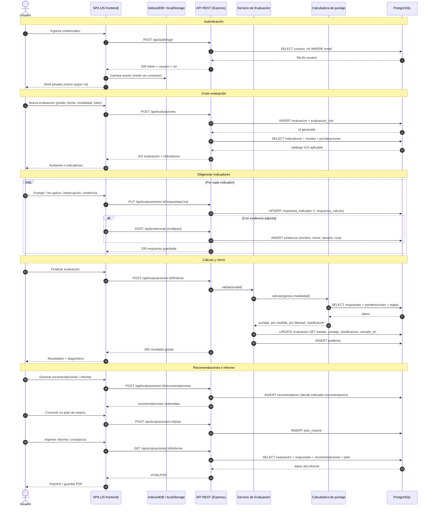

# Diseño de base de datos y UML — Bienestar Acuático · Neon Aquaculture

Documento de diseño previo a la implementación. Reemplaza la persistencia local
(`localStorage` + `IndexedDB`) por una base de datos relacional real, manteniendo
todas las funcionalidades actuales (predios, evaluaciones, cálculo ICA, recomendaciones,
plan de mejora, informes/constancias, historial, tablero, administración y auditoría).

Referencia metodológica: `docs/Metodologia_ICA_Bienestar_Peces_v2.pdf` (ICA v2.0, 2024),
secciones 5 a 8 y tablas 1–49.

---

## 1. Diagrama Entidad-Relación (ER)

```mermaid
erDiagram
    rol ||--o{ usuario : "asigna"
    departamento ||--o{ municipio : "contiene"
    departamento ||--o{ predio : "ubica"
    municipio ||--o{ predio : "ubica"
    tipo_productor ||--o{ predio : "clasifica"
    tipo_productor ||--o{ modalidad : "aplica"
    predio ||--o{ predio_sistema : "opera"
    sistema_productivo ||--o{ predio_sistema : "se_usa_en"
    predio ||--o{ lote_predio : "tiene"
    especie ||--o{ lote_predio : "cultiva"
    predio ||--o{ evaluacion : "recibe"
    usuario ||--o{ evaluacion : "realiza"
    modalidad ||--o{ evaluacion : "define"
    especie ||--o{ evaluacion : "evaluada_en"
    modalidad ||--o{ ponderacion : "pondera"
    tipo_medida ||--o{ ponderacion : "pesa"
    tipo_medida ||--o{ indicador : "agrupa"
    indicador ||--o{ indicador_libertad : "relaciona"
    libertad ||--o{ indicador_libertad : "aplica"
    indicador ||--o{ indicador_nivel : "escala"
    modalidad ||--o{ regla_muestreo : "define"
    modalidad ||--o{ regla_profundidad : "define"
    especie ||--o{ regla_mortalidad : "define"
    modalidad ||--o{ regla_mortalidad : "define"
    evaluacion ||--o{ evaluacion_lote : "selecciona"
    evaluacion ||--o| evaluacion_muestreo : "registra"
    evaluacion ||--o{ respuesta_indicador : "diligencia"
    indicador ||--o{ respuesta_indicador : "responde"
    respuesta_indicador ||--o{ respuesta_calculo : "guarda"
    respuesta_indicador ||--o{ evidencia : "adjunta"
    evaluacion ||--o{ recomendacion : "genera"
    indicador ||--o{ recomendacion : "origina"
    evaluacion ||--o{ plan_mejora : "planifica"
    usuario ||--o{ auditoria : "produce"

    rol {
        int id PK
        string codigo UK
        string nombre
        string descripcion
    }
    usuario {
        int id PK
        string nombre
        string email UK
        string password_hash
        int rol_id FK
        boolean activo
        timestamp creado_en
    }
    departamento {
        int id PK
        string nombre UK
    }
    municipio {
        int id PK
        string nombre
        int departamento_id FK
    }
    tipo_productor {
        int id PK
        string nombre UK
        int modalidad_id FK
    }
    sistema_productivo {
        int id PK
        string nombre UK
        string densidad_ref
    }
    especie {
        int id PK
        string codigo UK
        string nombre_comun
        string nombre_cientifico
        string tipo_agua
        decimal temp_min
        decimal temp_max
        decimal od_min
        decimal ph_min
        string turbidez_ref
        boolean turbidez_aplica
        boolean activo
    }
    predio {
        int id PK
        string codigo UK
        string nombre
        string responsable
        string email
        int tipo_productor_id FK
        int departamento_id FK
        int municipio_id FK
        string vereda
        string direccion
        decimal latitud
        decimal longitud
        boolean activo
    }
    predio_sistema {
        int id PK
        int predio_id FK
        int sistema_productivo_id FK
    }
    lote_predio {
        int id PK
        int predio_id FK
        int especie_id FK
        int cantidad
        int peso_promedio_g
        int numero_lotes
    }
    modalidad {
        int id PK
        string codigo UK
        string nombre
        decimal peso_mbr
        decimal peso_mba
        decimal peso_mbg
    }
    tipo_medida {
        int id PK
        string codigo UK
        string nombre
        string descripcion
    }
    ponderacion {
        int id PK
        int modalidad_id FK
        int tipo_medida_id FK
        decimal peso_pct
    }
    libertad {
        int id PK
        string nombre UK
        string descripcion
    }
    indicador {
        int id PK
        string codigo UK
        int tipo_medida_id FK
        string nombre
        string descripcion
        string pregunta
        string metodo
        string no_aplica
        string recomendacion
        boolean aplica_pmg
        boolean aplica_arel
        string calculadora
    }
    indicador_libertad {
        int id PK
        int indicador_id FK
        int libertad_id FK
    }
    indicador_nivel {
        int id PK
        int indicador_id FK
        int puntaje
        string descripcion
    }
    regla_muestreo {
        int id PK
        int modalidad_id FK
        int min_lotes
        int max_lotes
        int lotes_a_muestrear
    }
    regla_profundidad {
        int id PK
        int modalidad_id FK
        boolean es_jaula
        decimal min_m
        decimal max_m
    }
    regla_mortalidad {
        int id PK
        int especie_id FK
        int modalidad_id FK
        decimal umbral_100
        decimal umbral_55
        decimal umbral_20
    }
    evaluacion {
        int id PK
        int predio_id FK
        int evaluador_id FK
        int modalidad_id FK
        int especie_id FK
        date fecha
        int lotes_sembrados
        string estado
        decimal puntaje_global
        string clasificacion
        string etapa_visita
        timestamp cerrado_en
        timestamp actualizado_en
    }
    evaluacion_lote {
        int id PK
        int evaluacion_id FK
        string nombre_lote
    }
    evaluacion_muestreo {
        int id PK
        int evaluacion_id FK
        int especie_id FK
        int cantidad_evaluada
        int peso_promedio_g
        string lote_ref
    }
    respuesta_indicador {
        int id PK
        int evaluacion_id FK
        int indicador_id FK
        int puntaje
        boolean no_aplica
        string observacion
        timestamp actualizado_en
    }
    respuesta_calculo {
        int id PK
        int respuesta_id FK
        string clave
        string valor
    }
    evidencia {
        int id PK
        int respuesta_id FK
        string nombre_archivo
        string tipo_mime
        int tamano_bytes
        string almacenamiento
        timestamp subido_en
    }
    recomendacion {
        int id PK
        int evaluacion_id FK
        int indicador_id FK
        string titulo
        string texto
        int puntaje_ref
        int orden
    }
    plan_mejora {
        int id PK
        int evaluacion_id FK
        string accion
        string responsable
        string prioridad
        date plazo
        boolean completado
    }
    auditoria {
        int id PK
        int usuario_id FK
        string accion
        string entidad
        int entidad_id
        timestamp fecha_hora
    }
    categoria_clasificacion {
        int id PK
        string nombre UK
        decimal min_pct
        decimal max_pct
        string color
        string descripcion
    }
```

---

## 2. Diagrama de Clases (UML)

```mermaid
classDiagram
    namespace Frontend_JS {
        class AppController {
            -estado UIState
            +init()
            +navegar(ruta)
            +render()
        }
        class Router {
            +resolver(hash)
            +montarVista(vista)
        }
        class ApiClient {
            -baseUrl string
            -token string
            +login(email, pass)
            +get(recurso)
            +post(recurso, datos)
            +put(recurso, datos)
            +del(recurso)
            +subirArchivo(formData)
        }
        class Persistencia {
            <<interface>>
            +guardarBorrador(clave, valor)
            +leerBorrador(clave)
            +sincronizar()
        }
        class LocalStorageAdapter
        class ApiAdapter
        class AuthService {
            +login()
            +logout()
            +registrar()
            +sesionActual()
        }
        class PredioService {
            +listar()
            +crear(datos)
            +actualizar(id, datos)
            +eliminar(id)
        }
        class CatalogoService {
            +indicadores(modalidad)
            +especies()
            +modalidades()
            +sistemas()
        }
        class EvaluacionService {
            +crear(datos)
            +respuestas(evalId)
            +guardarRespuesta(evalId, indId, datos)
            +finalizar(evalId)
        }
        class CalculoService {
            +calcular(respuestas, pesos)
            +porTipoMedida()
            +porLibertad()
            +clasificar(total)
        }
        class RecomendacionService {
            +generar(evalId)
            +planDesdeRecomendaciones(evalId)
        }
        class EvidenciaService {
            +subir(respuestaId, archivo)
            +listar(respuestaId)
        }
        class ReporteService {
            +informe(evalId)
            +constancia(evalId)
        }
        class DashboardService {
            +agregados(filtros)
            +comparar(a, b)
        }
        class FxEngine {
            +transition(cb)
            +afterRender()
            +hydrate(root)
        }
        class LandingView
        class AuthView
        class PredioView
        class EvaluacionView
        class IndicadorView
        class ResultadoView
        class HistorialView
        class TableroView
        class AdminView
        class InformeView
    }

    namespace Backend_Node {
        class ApiServer {
            +middlewares()
            +rutas()
        }
        class BaseDatos {
            -pool
            +query(sql, params)
            +transaccion(cb)
        }
        class UsuarioRepositorio
        class PredioRepositorio
        class EvaluacionRepositorio
        class IndicadorRepositorio
        class ReporteRepositorio
        class AuditoriaRepositorio
        class AuthController
        class EvaluacionController
        class CalculoDominio {
            +puntajeGlobal(respuestas, ponderaciones)
            +validarCierre(respuestas)
        }
    }

    namespace Dominio {
        class Usuario
        class Predio
        class Evaluacion
        class Indicador
        class NivelIndicador
        class RespuestaIndicador
        class Recomendacion
        class PlanMejora
        class Especie
        class Modalidad
    }

    AppController --> Router
    AppController --> AuthService
    Router --> LandingView
    Router --> AuthView
    Router --> PredioView
    Router --> EvaluacionView
    Router --> IndicadorView
    Router --> ResultadoView
    Router --> HistorialView
    Router --> TableroView
    Router --> AdminView
    Router --> InformeView
    AppController --> FxEngine
    AuthService --> ApiClient
    PredioService --> ApiClient
    CatalogoService --> ApiClient
    EvaluacionService --> ApiClient
    RecomendacionService --> ApiClient
    EvidenciaService --> ApiClient
    ReporteService --> ApiClient
    DashboardService --> ApiClient
    ApiClient ..|> Persistencia
    LocalStorageAdapter ..|> Persistencia
    ApiAdapter ..|> Persistencia
    ApiClient --> ApiServer : HTTPS/REST
    ApiServer --> AuthController
    ApiServer --> EvaluacionController
    ApiServer --> UsuarioRepositorio
    ApiServer --> PredioRepositorio
    ApiServer --> EvaluacionRepositorio
    ApiServer --> IndicadorRepositorio
    ApiServer --> ReporteRepositorio
    ApiServer --> AuditoriaRepositorio
    EvaluacionController --> CalculoDominio
    CalculoDominio --> EvaluacionRepositorio
    UsuarioRepositorio --> BaseDatos
    PredioRepositorio --> BaseDatos
    EvaluacionRepositorio --> BaseDatos
    IndicadorRepositorio --> BaseDatos
    ReporteRepositorio --> BaseDatos
    AuditoriaRepositorio --> BaseDatos
    EvaluacionView --> Evaluacion
    EvaluacionView --> Predio
    IndicadorView --> Indicador
    IndicadorView --> NivelIndicador
    ResultadoView --> Recomendacion
```

---

## 3. Diagrama de Secuencia (frontend ↔ API ↔ base de datos)

---

## 4. Trazabilidad Metodología ICA v2.0 → modelo

| Requerimiento ICA (v2.0, 2024) | Tabla(s) / campo(s) |
|---|---|
| 23 indicadores PMG · 15 AREL · 3 tipos de medida | `indicador` (`aplica_pmg`, `aplica_arel`, `tipo_medida_id`) |
| Escala 0 / 20 / 55 / 100 (§5.4) | `indicador_nivel` |
| Ponderación PMG 35/35/30 · AREL 40/40/20 (§5.5, §8) | `modalidad`, `ponderacion` |
| Clasificación Bajo/Medio/Alto/Excelente (§5.5) | `categoria_clasificacion` |
| Las 5 libertades (§5.6, tablas 2 y 31) | `libertad`, `indicador_libertad` |
| Muestreo por lotes (tabla 1 PMG, tabla 30 AREL) | `regla_muestreo` |
| Valores de agua (tablas 6 y 35) y excepción biofloc | `especie` (`temp_*`, `od_min`, `ph_min`, `turbidez_ref`, `turbidez_aplica`) |
| Umbrales de mortalidad (tablas 23 y 48) | `regla_mortalidad` |
| Rango de profundidad (tabla 13 PMG jaulas 2–5 m · tabla 40 AREL 0,6–1,5 m) | `regla_profundidad` |
| Etapas de la visita I–IV (§6) | `evaluacion.etapa_visita` |
| Recomendaciones y plan de mejora | `recomendacion`, `plan_mejora` |
| Trazabilidad / auditoría | `auditoria` |
| Evidencias fotográficas/documentales | `evidencia` |

> Nota académica conservada: el apartado general del PDF menciona 24 indicadores, pero el
> listado detallado usado por el prototipo contiene 23 PMG y 15 AREL. Se mantiene 23/15 y
> la diferencia se documenta; no se inventa un indicador adicional.
